# Evidencias de Despliegue y Observabilidad 100 % AWS (EP3)

Registro con capturas reales de la consola de AWS Academy (cuenta `196424683276`, región `us-east-1`), utilizando exclusivamente servicios nativos de AWS (**Amazon ECR**, **Amazon ECS Fargate**, **ECS Service Connect / Cloud Map** y **Amazon CloudWatch**).

---

## 1. Imágenes versionadas en Amazon ECR

En lugar de reconstruir la imagen en el runner durante el despliegue, las 3 imágenes fueron versionadas (`1.0.0`) y publicadas en repositorios privados de **Amazon ECR** con `scanOnPush=true`:

- `196424683276.dkr.ecr.us-east-1.amazonaws.com/backend1-service:1.0.0`
- `196424683276.dkr.ecr.us-east-1.amazonaws.com/backend2-service:1.0.0`
- `196424683276.dkr.ecr.us-east-1.amazonaws.com/frontend-service:1.0.0`

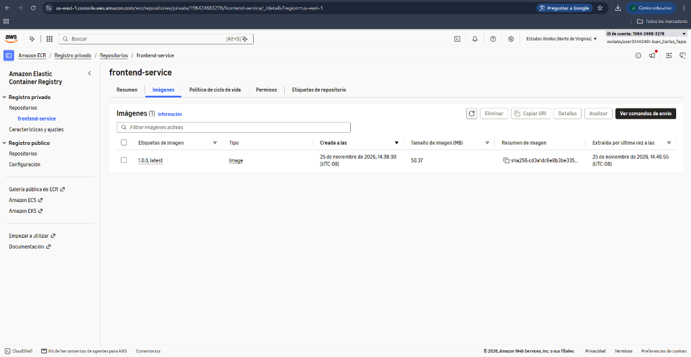

---

## 2. Red, Security Group y Clúster ECS Fargate (IE2)

- **Security Group:** `doy0101-microservicios-sg` (`sg-08cbdfc736320fb9c`) — `TCP 5000` público (`0.0.0.0/0`) y `TCP 5001-5002` restringido al CIDR de la VPC (`172.31.0.0/16`).
- **Clúster ECS:** `doy0101-ecs` (`Activo`, Fargate, **Container Insights con observabilidad mejorada**, **Service Connect: `microservices-demo`**), con `backend1`, `backend2` y `frontend` en **`1/1` tareas en ejecución**.

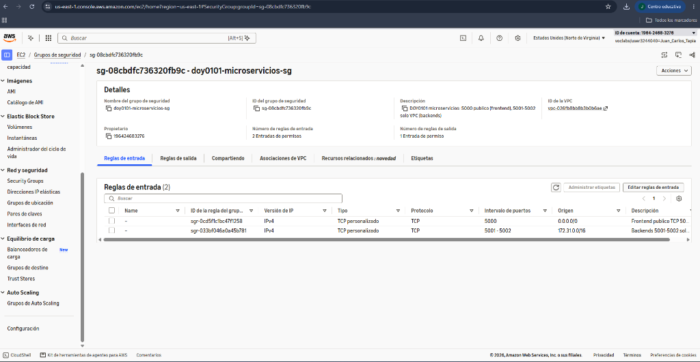
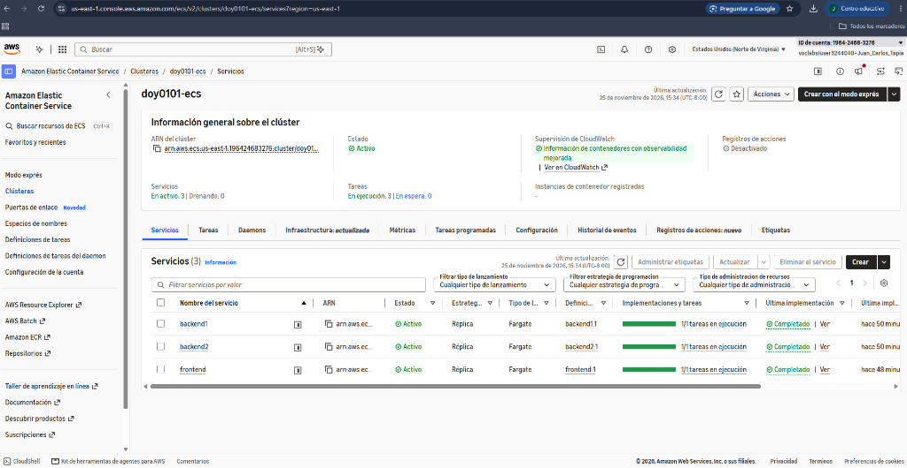

### Aplicación web funcionando (`http://3.91.8.147:5000`)

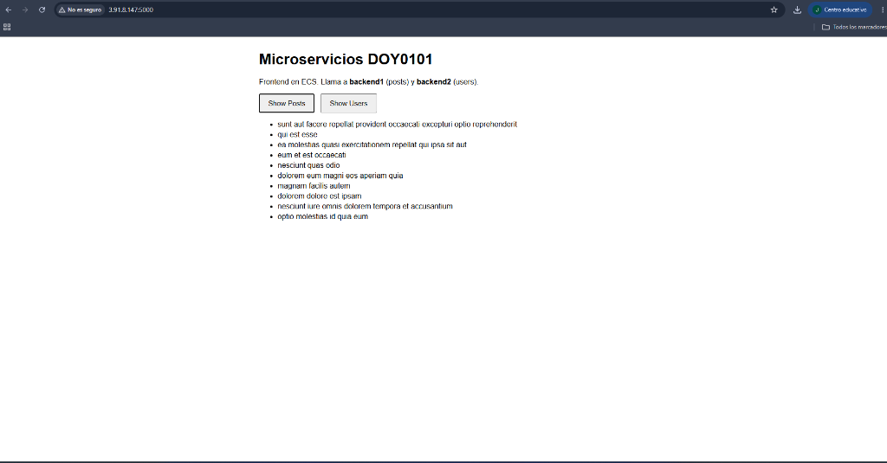
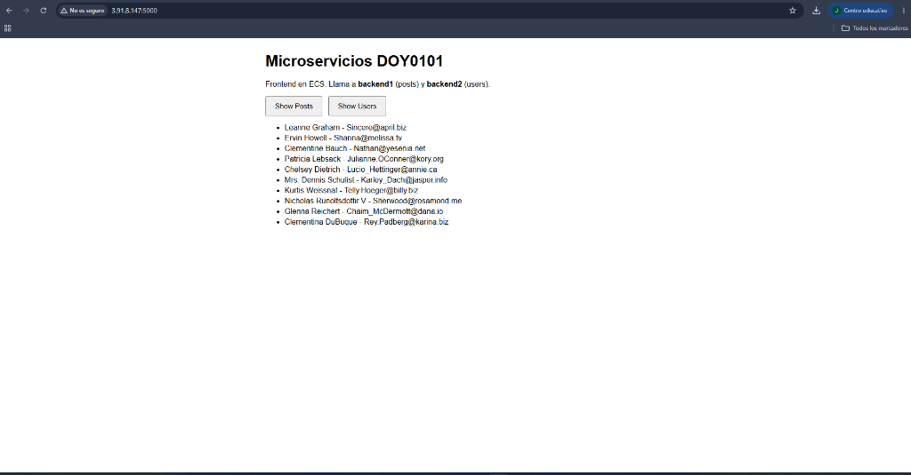

---

## 3. Monitoreo, Logs y Alarmas en Amazon CloudWatch (IE1)

Las 5 alarmas configuradas (disponibilidad de los 3 servicios + errores HTTP 5xx de ambos backends) se encuentran en estado **`CORRECTO` (`OK`)**:

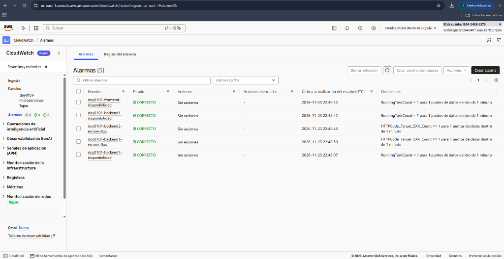
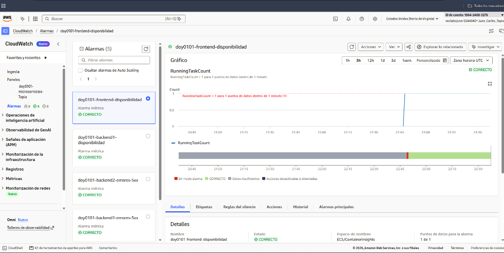
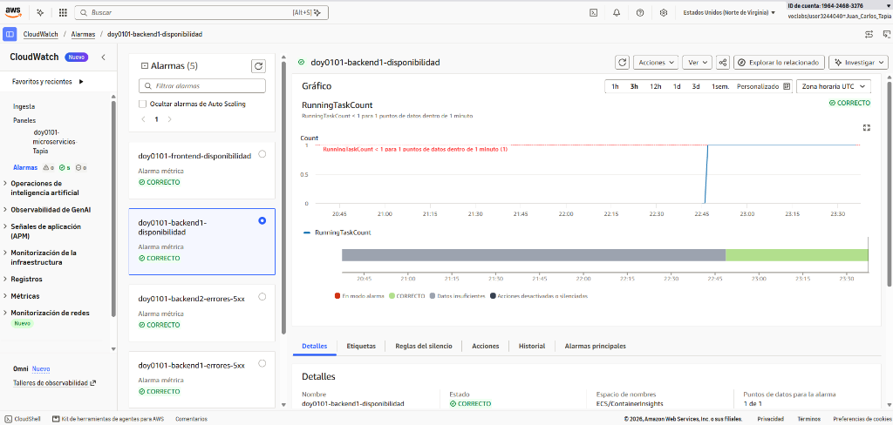
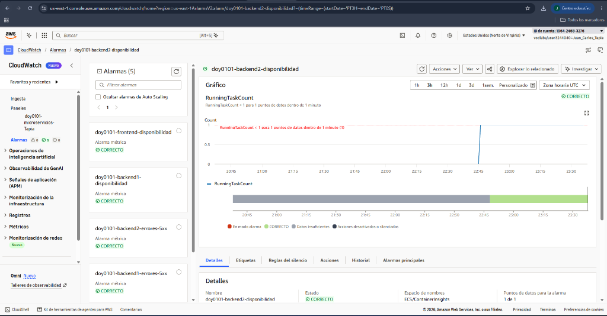
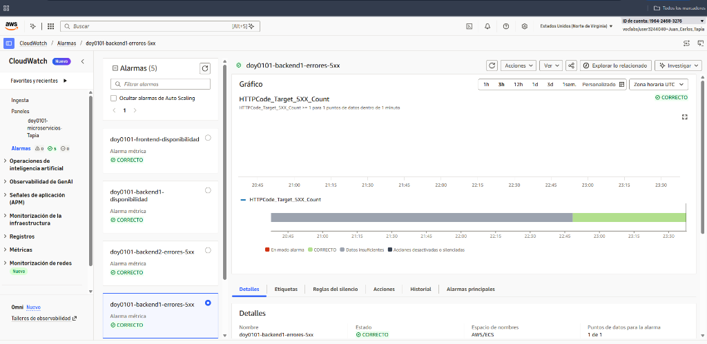
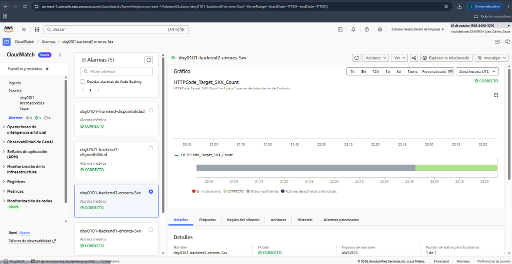

### Muestra de CloudWatch Logs (`/ecs/frontend`) con errores 404 controlados

```text
191.113.246.131 - - [25/Nov/2026 22:49:42] "GET /no-existe HTTP/1.1" 404 -
191.113.246.131 - - [25/Nov/2026 22:49:43] "GET /no-existe HTTP/1.1" 404 -
191.113.246.131 - - [25/Nov/2026 22:49:44] "GET /no-existe HTTP/1.1" 404 -
```

---

## 4. Dashboard `doy0101-microservicios-Tapia` integrado al CI/CD (IE3)

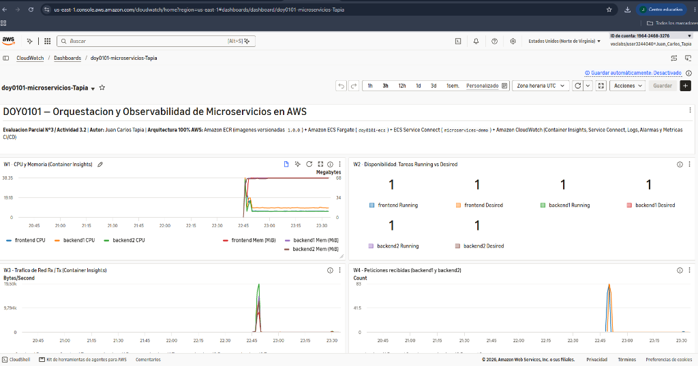

### Detalle de widgets Service Connect (W5 – W8) y métricas CI/CD (`DOY0101/CICD` — W9)

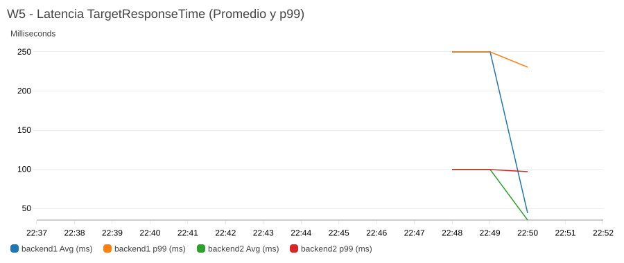
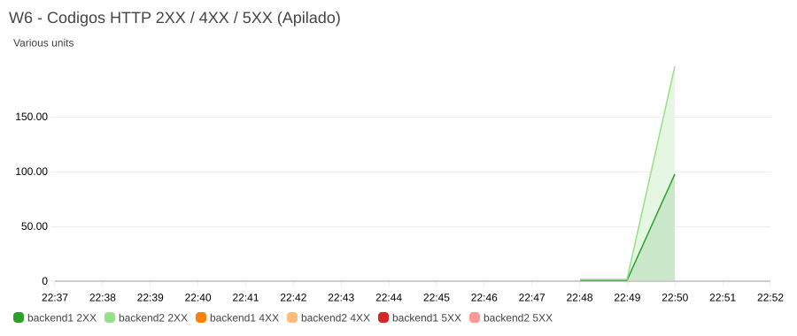
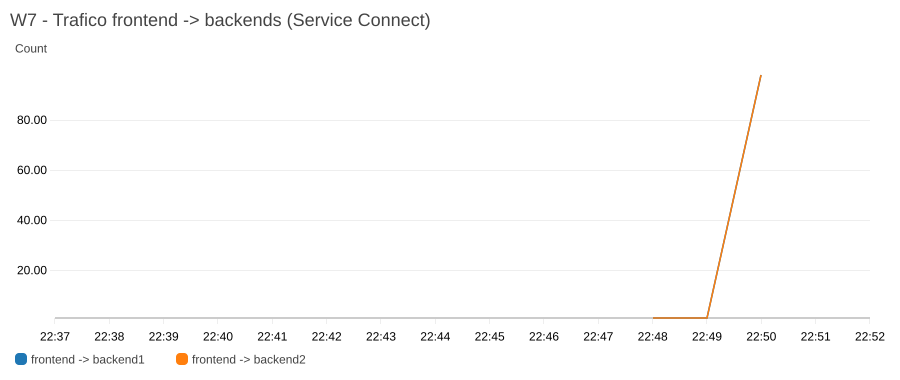
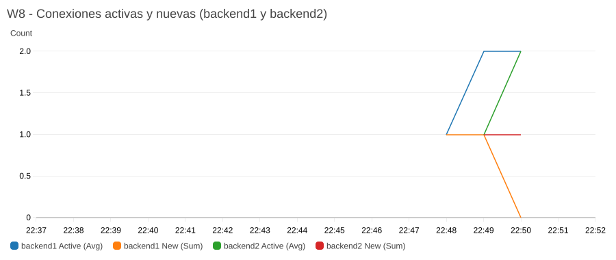
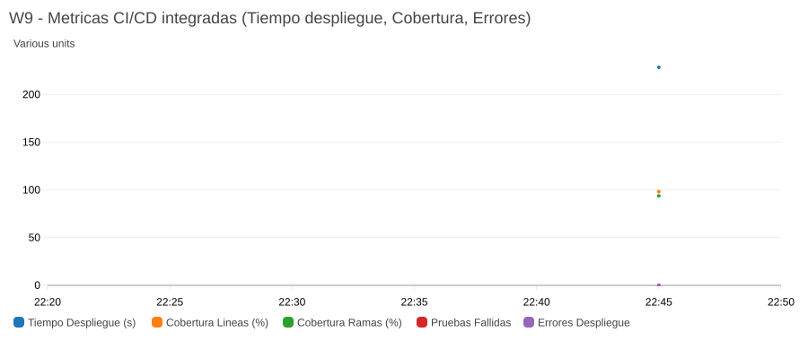
