# Informe — Orquestación de Microservicios en Amazon ECS y Dashboard en CloudWatch

**Asignatura:** DOY0101 — Ingeniería DevOps (Duoc UC)  
**Evaluación / Actividad:** Evaluación Parcial N°3 · Actividad 3.2  

## Identificación del equipo

| Campo | Detalle |
|---|---|
| **Integrante 1** | Juan Carlos Tapia |
| **Sección** | 801D |
| **Fecha** | 25/11/2026 |
| **Cuenta AWS Academy** | `196424683276` (`us-east-1`) |

---

## Parte 1 – Conceptos de orquestación

- **P1. Orquestación de contenedores (ECS vs `docker compose up`):**  
  La orquestación administra de forma automática el ciclo de vida de múltiples contenedores en la nube: programación en cómputo serverless (Fargate), autorrecuperación cuando una tarea falla, escalado horizontal sin caída, descubrimiento de servicios y monitoreo integrado en CloudWatch, a diferencia de `docker compose up` que depende de un único equipo local.

- **P2. Task Definition vs Task vs Service en ECS (y equivalencia en Kubernetes):**  
  - **Task Definition** ≈ *PodSpec / plantilla de Deployment*: define imagen (Amazon ECR), CPU/memoria, puertos, variables y logs.  
  - **Task** ≈ *Pod*: instancia en ejecución creada a partir de la definición de tarea.  
  - **Service** ≈ *Deployment + Service*: mantiene la cantidad deseada de tareas activas, reemplaza tareas fallidas y gestiona la conectividad con Service Connect.

- **P3. ECS Service Connect, Cloud Map (`microservices-demo`) y proxy Envoy (sidecar):**  
  Service Connect inyecta un proxy sidecar Envoy junto a cada tarea; AWS Cloud Map registra el espacio de nombres `microservices-demo` para resolver nombres lógicos (`backend1-service:5001` y `backend2-service:5002`) y Envoy enruta el tráfico HTTP emitiendo automáticamente métricas de peticiones, latencia, códigos HTTP y conexiones hacia CloudWatch.

---

## Parte 2 – Grupo de seguridad y clúster ECS

- **VPC predeterminada:** `vpc-026fb8bb8b3b0b6ae` (`172.31.0.0/16`)
- **Grupo de seguridad:** `doy0101-microservicios-sg` (`sg-08cbdfc736320fb9c`)
  - `TCP 5000` ← `0.0.0.0/0` (acceso público al frontend)
  - `TCP 5001-5002` ← `172.31.0.0/16` (acceso interno exclusivo a `backend1` y `backend2`)
- **Clúster ECS:** `doy0101-ecs` (`Activo`, Fargate, **Container Insights con observabilidad mejorada**, **Service Connect: `microservices-demo`**)

### EVIDENCIA N° 1 – Reglas de entrada del Security Group y clúster ECS activo

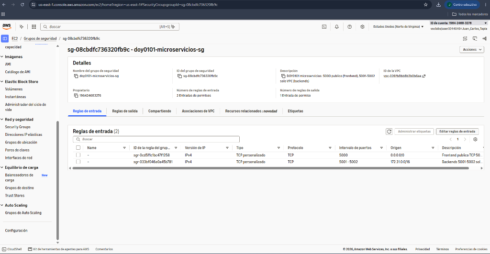

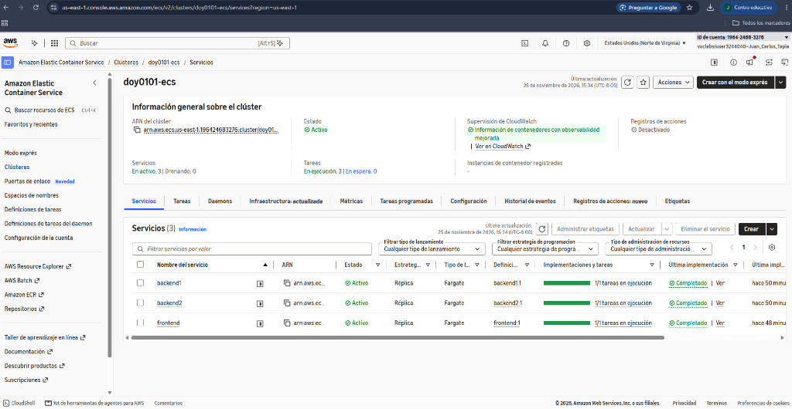

- **P4. ¿Por qué el puerto 5000 es público y 5001–5002 solo al CIDR de la VPC?**  
  Por principio de mínimo privilegio: solo el `frontend` requiere acceso desde Internet. Abrir 5001–5002 a `0.0.0.0/0` expondría directamente los backends a clientes externos sin pasar por el frontend ni por el control interno de la VPC.

---

## Parte 3 – Definiciones de tareas e imágenes versionadas en Amazon ECR

Las 3 imágenes fueron publicadas con tag versionado **`1.0.0`** en **Amazon ECR** (`us-east-1`, `scanOnPush=true`), evitando reconstruir imágenes en el runner durante el despliegue:

| Familia | URI de imagen versionada (Amazon ECR) | Recursos | Rol IAM | Puerto / Nombre | Protocolo | Log Group |
|---|---|---|---|---|---|---|
| `backend1` | `196424683276.dkr.ecr.us-east-1.amazonaws.com/backend1-service:1.0.0` | 0.25 vCPU / 0.5 GB | `LabRole` | `5001` / `backend1-http` | HTTP | `/ecs/backend1` |
| `backend2` | `196424683276.dkr.ecr.us-east-1.amazonaws.com/backend2-service:1.0.0` | 0.25 vCPU / 0.5 GB | `LabRole` | `5002` / `backend2-http` | HTTP | `/ecs/backend2` |
| `frontend` | `196424683276.dkr.ecr.us-east-1.amazonaws.com/frontend-service:1.0.0` | 0.25 vCPU / 0.5 GB | `LabRole` | `5000` / `frontend-http` | HTTP | `/ecs/frontend` |

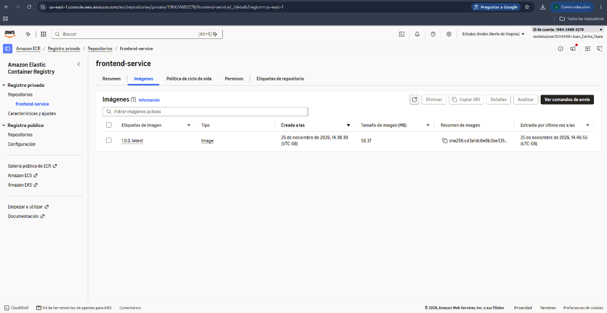

---

## Parte 4 – Servicios con Service Connect y prueba de la aplicación

### EVIDENCIA N° 2 – Aplicación web funcionando en `http://3.91.8.147:5000`

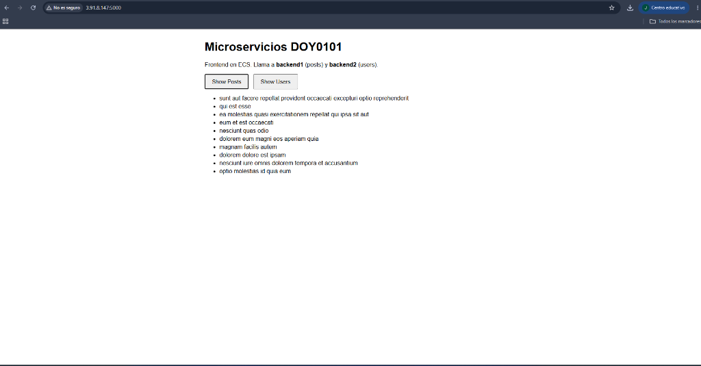

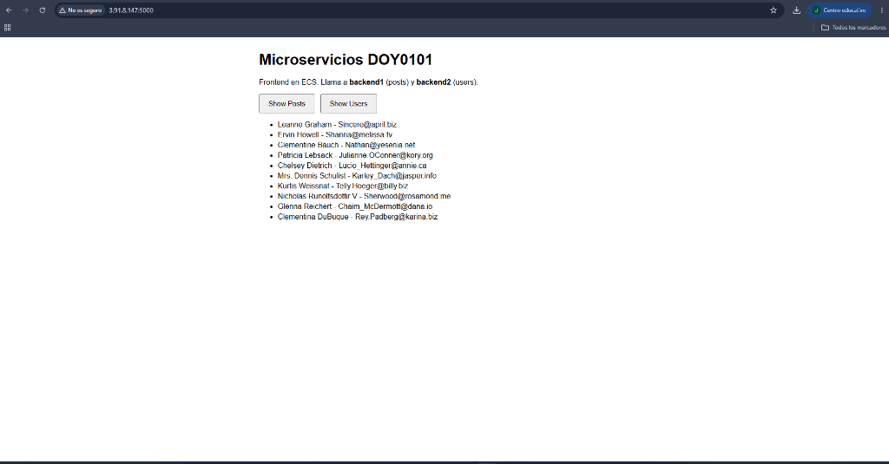

- **P5. ¿Por qué `frontend` es Solo Cliente y los backends Cliente y Servidor?**  
  Los backends exponen endpoints descubiertos por otros servicios en `microservices-demo` (`backend1-service:5001` y `backend2-service:5002`), mientras que `frontend` solo consume a los backends y atiende peticiones externas por su IP pública. Si `frontend` arranca antes que los backends, las llamadas fallan porque el mapa de Service Connect aún no registra esos destinos.

---

## Parte 5 – Generación de tráfico

### EVIDENCIA N° 3 – Tráfico HTTP y registro en CloudWatch Logs

Se ejecutó `.\infra\aws\generate-traffic.ps1 -Ip 3.91.8.147 -Iterations 150 -ErrorRequests 40`, enviando **300 peticiones válidas** (`POST /show_posts` y `POST /show_users`) más **40 errores 404 controlados** (`GET /no-existe`), registrados en `/ecs/frontend`:

```text
191.113.246.131 - - [25/Nov/2026 22:49:42] "GET /no-existe HTTP/1.1" 404 -
191.113.246.131 - - [25/Nov/2026 22:49:43] "GET /no-existe HTTP/1.1" 404 -
191.113.246.131 - - [25/Nov/2026 22:49:44] "GET /no-existe HTTP/1.1" 404 -
```

---

## Parte 6 – Dashboard y Alarmas en Amazon CloudWatch

### EVIDENCIA N° 4 – Dashboard `doy0101-microservicios-Tapia` en la consola de AWS

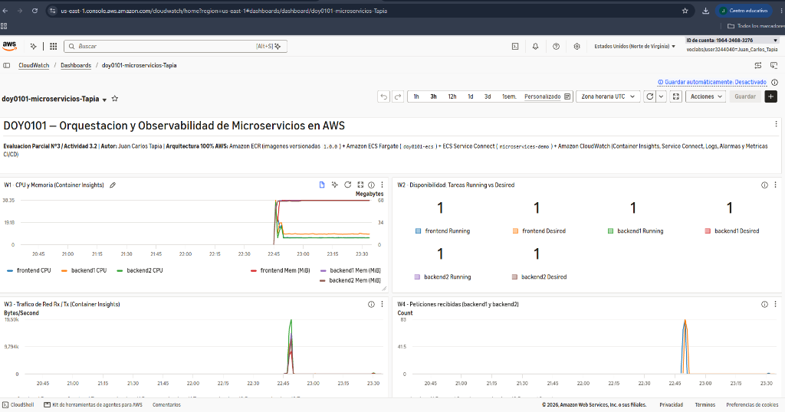

### EVIDENCIA N° 5 – Widgets ampliados de Service Connect y métricas CI/CD (`DOY0101/CICD`)

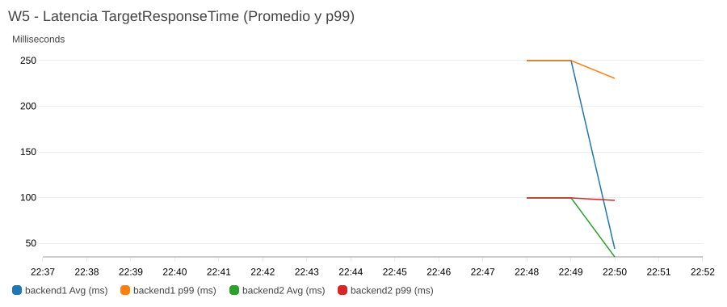
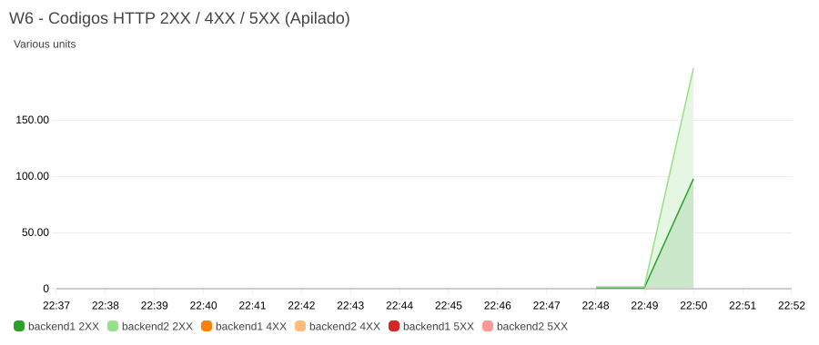
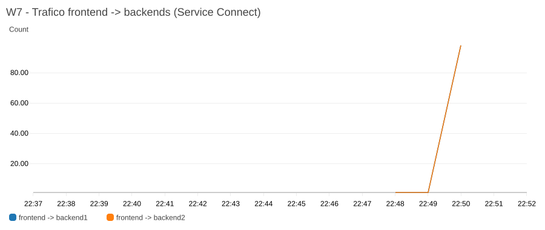
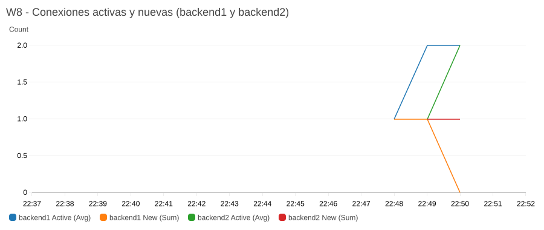
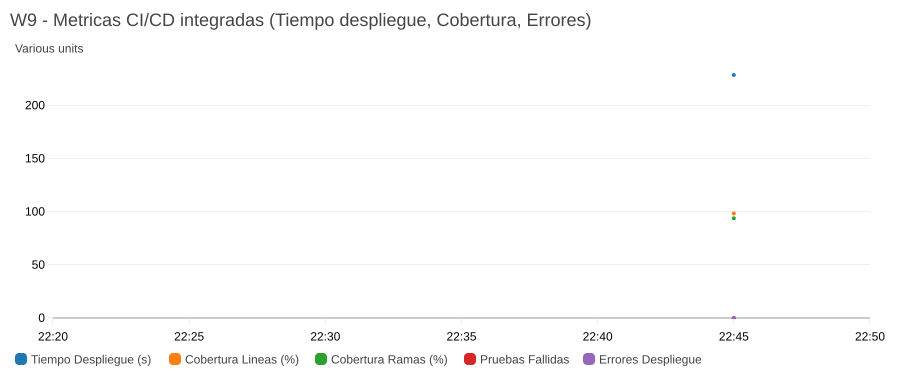

### Alarmas configuradas en CloudWatch (5/5 en estado `CORRECTO`)

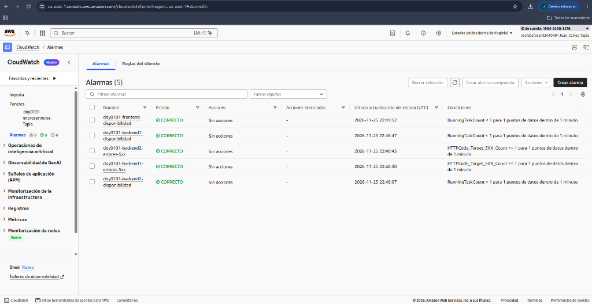
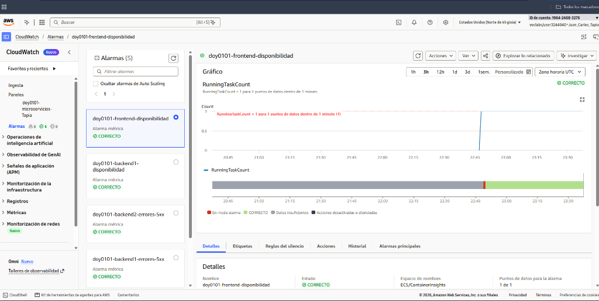
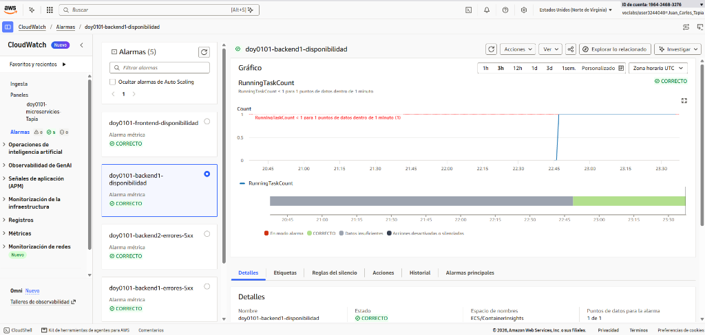
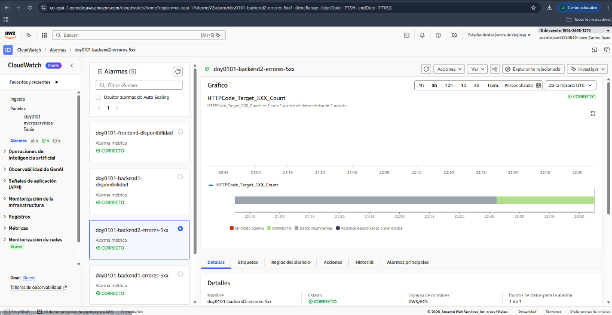
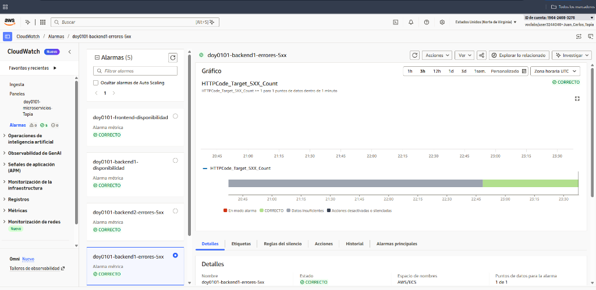
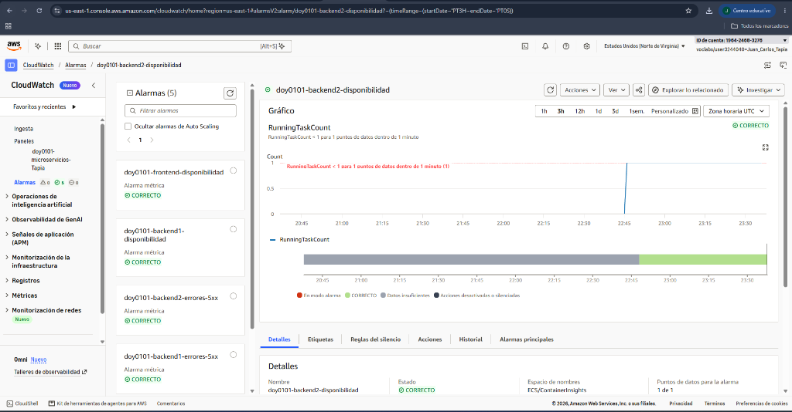

---

## Parte 7 – Explicación de las 14 métricas del dashboard

| Métrica / Espacio de nombres | Unidad | ¿Qué mide? | Valor observado real | ¿Qué indica en producción? |
|---|---|---|---|---|
| `CpuUtilized` (`ECS/ContainerInsights`) | CPU units (1024 = 1 vCPU) | Consumo real de CPU de las tareas del servicio. | `frontend`: ~24; `backend1`: ~18–37; `backend2`: ~12–36 | Si se acerca al límite (256 units) habrá throttling y mayor latencia; exige escalar tareas o subir vCPU. |
| `MemoryUtilized` (`ECS/ContainerInsights`) | MiB | Memoria RAM utilizada por los contenedores del servicio. | `frontend`, `backend1`, `backend2`: ~65–68 MiB (~13 % de 512 MiB) | Si crece sin bajar indica fuga de memoria; al tocar 512 MiB Fargate mata la tarea por OOMKill. |
| `RunningTaskCount` (`ECS/ContainerInsights`) | Count | Número de tareas actualmente en estado `RUNNING`. | `1` en `frontend`, `backend1` y `backend2` | Si cae a `0` hay indisponibilidad total; activa la alarma `doy0101-*-disponibilidad`. |
| `DesiredTaskCount` (`ECS/ContainerInsights`) | Count | Cantidad de tareas objetivo configuradas en el servicio ECS. | `1` en los 3 servicios | Si `Running < Desired` de forma sostenida indica tareas fallando al arrancar o falta de capacidad. |
| `NetworkRxBytes` (`ECS/ContainerInsights`) | Bytes/s | Tráfico de red entrante recibido por el servicio. | Pico de ~19,59 KB/s durante la prueba de carga | Caída brusca a `0` indica pérdida de tráfico entrante; picos anómalos alertan sobre carga inesperada. |
| `NetworkTxBytes` (`ECS/ContainerInsights`) | Bytes/s | Tráfico de red saliente enviado por el servicio. | Picos proporcionales a las respuestas JSON/HTML enviadas | Crecimiento desproporcionado respecto a `RequestCount` sugiere payloads pesados o sin paginar. |
| `RequestCount` servidor (`AWS/ECS`, `DiscoveryName`) | Count | Total de peticiones HTTP recibidas por `backend1` y `backend2` vía Envoy. | Pico de ~83–98 req/min por backend | Si cae a `0` habiendo tráfico en `frontend`, el backend no está recibiendo solicitudes. |
| `RequestCountPerTarget` cliente (`AWS/ECS`, `TargetDiscoveryName`) | Count | Peticiones HTTP enviadas desde `frontend` hacia cada backend destino. | `frontend → backend1`: ~98 req/min; `frontend → backend2`: ~98 req/min | Discrepancias frente al servidor revelan timeouts o rechazos antes de alcanzar el destino. |
| `TargetResponseTime` (`AWS/ECS`) | Milisegundos (ms) | Latencia de respuesta de los backends (promedio y percentil p99). | `backend1`: ~45 ms avg / ~230 ms p99; `backend2`: ~35 ms avg / ~97 ms p99 | Si el p99 sube mucho más que el promedio hay colas o cuellos de botella intermitentes. |
| `HTTPCode_Target_2XX_Count` (`AWS/ECS`) | Count | Respuestas HTTP exitosas (200–299) devueltas por los backends. | ~195 respuestas `2XX` apiladas en el minuto pico | Confirma salud funcional; una caída brusca junto a 4XX/5XX señala degradación. |
| `HTTPCode_Target_4XX_Count` (`AWS/ECS`) | Count | Errores de cliente (400–499) devueltos por los backends. | `0` en backends (los 40 `404` se registraron en `/ecs/frontend`) | Incrementos indican rutas mal configuradas o intentos de acceso a rutas inexistentes. |
| `HTTPCode_Target_5XX_Count` (`AWS/ECS`) | Count | Errores internos del servidor (500–599) en los backends. | `0` en ambos backends | Cualquier valor `>= 1` indica fallo crítico interno y dispara las alarmas `doy0101-*-errores-5xx`. |
| `ActiveConnectionCount` (`AWS/ECS`) | Count | Conexiones TCP/HTTP activas simultáneamente hacia cada backend. | `2` conexiones activas en `backend1` y `backend2` | Crecimiento sostenido sin liberar indica conexiones colgadas o saturación del backend. |
| `NewConnectionCount` (`AWS/ECS`) | Count | Nuevas conexiones abiertas hacia cada backend en el periodo. | `1` nueva conexión en `backend1` y `backend2` | Pocas conexiones nuevas frente a muchas peticiones demuestra reutilización eficiente (keep-alive). |

---

## Conclusión del equipo

Se orquestaron los 3 microservicios (`frontend`, `backend1`, `backend2`) en Amazon ECS Fargate usando imágenes versionadas (`1.0.0`) desde Amazon ECR (sin reconstruir en el runner) y monitoreo centralizado en Amazon CloudWatch.

Durante el proceso aparecieron varias dificultades técnicas que hubo que resolver: la restricción de AWS que impide nombrar un Security Group empezando con `sg-`, el error de inicialización del rol de Service Connect al crear el clúster en una cuenta nueva, y el ajuste de dimensiones en el dashboard de CloudWatch porque la latencia y los códigos HTTP se publican desde `frontend` hacia cada backend.

Al enviar 300 peticiones válidas y 40 errores 404, se comprobó el consumo de CPU/memoria, el estado `1/1` de las tareas, las respuestas `2XX`, la latencia promedio/p99, los logs de errores 404 y las 5 alarmas en `OK`. Como decisiones de alcance, se definió trabajar únicamente con servicios nativos de AWS, usar los microservicios entregados versionados en ECR y verificar visualmente los gráficos y la aplicación web en ejecución.

---

## Lista de cotejo (autoevaluación)

| Criterio | Estado |
|---|---|
| Grupo de seguridad con `5000` público y `5001-5002` solo desde la VPC | ✅ Cumplido (`doy0101-microservicios-sg`) |
| Clúster `doy0101-ecs` Fargate con Container Insights y namespace `microservices-demo` | ✅ Cumplido (`observabilidad mejorada`) |
| 3 definiciones de tareas con imágenes versionadas en Amazon ECR (`:1.0.0`) y puertos HTTP nombrados | ✅ Cumplido |
| 3 servicios en `1/1` tareas con Service Connect y aplicación funcionando en el navegador | ✅ Cumplido (`http://3.91.8.147:5000`) |
| Tráfico generado y visible en las métricas | ✅ Cumplido (`150` ciclos + `40` errores `404`) |
| Dashboard `doy0101-microservicios-Tapia` con widget de texto y widgets W1–W11 con datos | ✅ Cumplido |
| Tabla de las 14 métricas completada con valores observados reales | ✅ Cumplido |
| Alarmas en CloudWatch (`5/5 CORRECTO`) e integración de métricas CI/CD (`DOY0101/CICD`) | ✅ Cumplido |
| Recursos eliminados al finalizar (`.\infra\aws\cleanup-ecs.ps1`) | ⏳ Ejecutar al cerrar la sesión |
